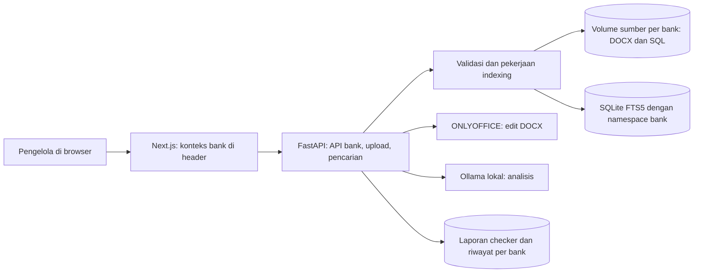

# Arsitektur Handover Multi-Bank TSD Engine

Dokumen ini adalah rancangan target untuk pengelolaan TSD Engine melalui browser.
Implementasi yang sudah ada dan pekerjaan lanjutan dibedakan di bagian akhir.

## 1. Kebutuhan Bisnis

- Bank yang dilayani saat ini: **SCB, DBS, SMBCI**.
- Seluruh DOCX dan skrip SQL yang sudah terpasang adalah sumber **SCB**.
- **DBS dan SMBCI dimulai kosong**. Jangan menyalin data SCB sebagai contoh di dua bank itu.
- Pengelola memilih bank sekali di header. Ringkasan, pencarian, repository,
  riwayat pemeriksaan, dan proses upload mengikuti bank aktif.
- Pengelola dapat memasukkan DOCX dan SQL baru lewat web tanpa menyentuh source
  code, Git, Docker volume, atau command parser.
- TSD yang belum lulus checker tetap di staging. SQL harus melalui validasi
  format dan pratinjau isi sebelum aktif di indeks.

## 2. Keputusan Arsitektur

Gunakan satu deployment Next.js + FastAPI + ONLYOFFICE + Ollama, dengan **ruang
penyimpanan sumber terpisah dan indeks SQLite yang dipartisi per bank**. Parser,
checker, pencarian FTS5, dan editor tetap digunakan, tetapi seluruh operasi
menerima `bank_id` yang tervalidasi. Kunci internal selalu memuat namespace
bank agar nama SP yang sama tidak bertabrakan.



`bank_id` hanya bernilai `SCB`, `DBS`, atau `SMBCI`. Cookie browser menyimpan
pilihan terakhir sebagai preferensi tampilan. Setiap request API tetap membawa
`bank_id`; backend memvalidasi nilai itu dan menentukan direktori/indeks dari
daftar tetap, bukan dari path bebas yang dikirim browser.

## 3. Model Data dan Penyimpanan Target

```text
tsd_samples/                         sumber asli, dicadangkan bersama volume
  SCB/docs/      SCB/sql/
  DBS/docs/      DBS/sql/
  SMBCI/docs/    SMBCI/sql/

tsd_storage/
  tsd_index.db                       indeks gabungan dengan namespace bank
  banks/DBS/     banks/SMBCI/
    registry.json
    parsed/docs/   parsed/sql/
    images/        pdf/
    quality/reports/   quality/staging/
    uploads/         jobs/
```

Sumber SCB lama tetap berada di volume `tsd_samples` agar instalasi yang sudah
berjalan tidak memerlukan pemindahan massal. Metadata indeks memberinya bank
SCB. Satu sumber mempunyai `document_id` atau `sql_source_id` yang tetap walaupun
nama file berubah. Metadata minimal: `bank_id`, nama asli, nama penyimpanan,
ukuran, SHA-256, versi, status, waktu upload, waktu aktivasi, dan pengguna yang
melakukan aksi. Unik berdasarkan `(bank_id, nama file)`, bukan nama file global.
File dengan hash sama dalam bank yang sama ditandai duplikat; hash sama pada
bank lain tidak menghubungkan kedua datanya.

Namespace bank membuat nama SP, segment, tabel, diagram, dan SQL yang sama
tidak saling menimpa. Pencarian SP `ABC` di DBS selalu menyertakan filter DBS.
Cache analisis AI memasukkan bank dan versi sumber dalam cache key.

## 4. Alur Pengelola di Web

1. Pilih SCB, DBS, atau SMBCI di header. Pilihan bertahan saat pindah halaman.
2. Halaman Ringkasan menampilkan angka dan grafik untuk bank aktif. Bila belum
   ada SQL atau TSD, tampilkan keadaan kosong yang jelas; jangan hitung cakupan
   dari database bank lain.
3. Halaman Sumber menyediakan dua tab: **Dokumen TSD** dan **Skrip SQL**.
   Masing-masing punya tombol Upload, daftar sumber, status, tanggal, serta
   aksi pratinjau/unduh/ganti/nonaktifkan.
4. Upload dapat memilih banyak file atau satu ZIP. Tampilkan ringkasan isi ZIP,
   file valid, file ditolak, dan duplikat sebelum konfirmasi. Arsip DOCX dan SQL
   diproses sebagai jenis sumber yang berbeda.
5. DOCX dari halaman Kelola Sumber divalidasi sebagai file Word, disimpan pada
   ruang bank aktif, diparse, lalu langsung dimasukkan ke indeks. Quality checker
   tetap tersedia di Repository untuk pemeriksaan rinci yang bersifat terpisah.
6. SQL divalidasi sebagai teks/skrip yang dapat diparse, ditampilkan nama SP
   yang ditemukan, jumlah duplikat, dan konflik nama. Pengelola menekan
   **Aktifkan sumber** setelah memeriksa hasil. Tidak perlu menyunting kode.
7. Aktivasi atau penggantian memicu pekerjaan indexing untuk bank itu saja.
   UI menampilkan status `Menunggu`, `Memproses`, `Selesai`, atau `Gagal` dengan
   pesan yang dapat ditindaklanjuti; pencarian lama tetap tersedia saat proses.
8. Pencarian dan detail SP hanya memakai bank aktif. Tautan detail membawa bank
   dalam URL agar hasil tidak berubah bila pilihan header diganti di tab lain.

Di header, tampilkan bank yang sedang aktif secara jelas. Pada layar kecil,
pemilih bank berada di baris tersendiri. Di halaman bank kosong, tampilkan
tombol **Unggah TSD** dan **Unggah SQL**; jangan tampilkan contoh SCB.

## 5. Pipeline Upload dan Indexing

### DOCX

Browser -> API upload -> validasi ukuran/nama/struktur -> staging per bank ->
checker -> persetujuan aktivasi -> simpan sumber versi baru -> parser DOCX ->
bangun indeks bank -> pindah status menjadi aktif.

### SQL

Browser -> API upload -> validasi ukuran/encoding/ekstensi -> staging per bank ->
parser SQL -> pratinjau SP/tabel/konflik -> persetujuan aktivasi -> simpan sumber
versi baru -> bangun indeks bank -> pindah status menjadi aktif.

Parser SQL hanya **membaca skrip**, tidak menjalankan perintah terhadap SQL
Server. SQLite digunakan untuk indeks dan metadata aplikasi, bukan pengganti
database operasional bank.

Untuk ZIP, cegah path traversal, nama ganda, arsip terenkripsi, dan arsip yang
meledak ukuran setelah diekstrak. Batasi jumlah dan total ukuran file. Semua
file dicek satu per satu; kegagalan satu file tidak menghapus hasil file lain.

Index baru dibangun di file sementara dan ditukar secara atomik setelah sukses.
Versi sumber sebelumnya tetap tersedia untuk rollback. Pekerjaan diantre per
bank sehingga upload SCB tidak memblokir pekerjaan DBS. Pada skala instalasi
tunggal, worker lokal cukup; message broker baru diperlukan bila beban nyata
meningkat.

## 6. Kontrak API Target

| Endpoint | Kegunaan |
| --- | --- |
| `GET /api/banks` | Tiga bank yang tersedia dan jumlah sumber per bank |
| `GET /api/banks/{bank}/stats` | Ringkasan bank terpilih |
| `GET /api/banks/{bank}/search` | Pencarian hanya dalam indeks bank |
| `GET /api/banks/{bank}/documents` | Daftar DOCX, status, dan riwayat |
| `POST /api/banks/{bank}/documents/check` | Upload DOCX ke staging dan checker |
| `POST /api/banks/{bank}/documents/{id}/activate` | Aktivasi DOCX yang lulus |
| `GET /api/banks/{bank}/sql-sources` | Daftar skrip SQL |
| `POST /api/banks/{bank}/sql-sources/check` | Upload SQL/ZIP dan pratinjau parse |
| `POST /api/banks/{bank}/sql-sources/{id}/activate` | Aktivasi SQL dan reindex |
| `GET /api/banks/{bank}/jobs/{id}` | Status pekerjaan indexing |

Endpoint dokumen lama bisa dipertahankan sementara sebagai alias SCB saat
migrasi. API baru harus menolak `bank_id` yang tidak dikenal dan memastikan ID
sumber yang diakses memang milik bank tersebut.

## 7. Akses, Operasional, dan Handover

Login lokal menggunakan satu akun pengelola dari `.env` dan sesi cookie
HTTP-only bertanda tangan. Untuk penggunaan bersama di kantor, integrasikan
autentikasi perusahaan sebelum akses jaringan diperluas. Peran minimum: pembaca
(lihat/cari/unduh) dan pengelola (upload/aktivasi/edit/nonaktifkan). Catat
pengguna, waktu, bank, jenis aksi, ID sumber, dan hasilnya di audit log.

Git menyimpan kode, konfigurasi, dokumentasi, dan template. Volume Docker
menyimpan DOCX, SQL, SQLite, laporan, dan model Ollama. Upload web masuk ke
volume, **bukan** ke Git. Backup terjadwal harus mencakup `tsd_samples`,
`tsd_storage`, dan volume lain yang diperlukan. Uji restore SCB/DBS/SMBCI
secara terpisah sebelum handover dianggap selesai.

## 8. Urutan Implementasi

| Tahap | Hasil yang dapat diverifikasi |
| --- | --- |
| 1. Konteks bank | Header berisi SCB/DBS/SMBCI; data lama berlabel SCB; dua bank lain kosong; halaman utama mengikuti pilihan. |
| 2. Isolasi sumber | Folder, registry, laporan, cache, dan indeks dipisah per bank; nama file/SP sama di bank berbeda tidak bentrok. |
| 3. Upload SQL web | Multi-file/ZIP, validasi, pratinjau, aktivasi, riwayat, dan pemulihan versi. |
| 4. Upload DOCX massal | Multi-file, hasil pemrosesan per file, aktivasi langsung, status pekerjaan. |
| 5. Operasional | Login/peran, audit log, backup otomatis, dan uji restore. |

## 9. Kondisi Implementasi Saat Dokumen Ini Dibuat

- Pemilih bank berlaku global untuk ringkasan, pencarian, repository, detail,
  editor, quality checker, dan halaman pengelolaan sumber.
- Data lama diberi namespace SCB; DBS dan SMBCI dimulai kosong.
- Sumber bank baru disimpan pada direktori terpisah dan kunci indeks memakai
  namespace bank sehingga nama file/SP yang sama tidak bentrok.
- Halaman **Kelola sumber** mendukung upload multi-file DOCX serta SQL secara
  langsung. DOCX divalidasi dan diparse tanpa quality checker; SQL diparse tanpa
  dieksekusi. Quality checker tetap tersedia sebagai fitur terpisah di Repository.
- Indeks masih satu file SQLite yang dipartisi secara ketat dengan kolom dan
  kunci bank. Pemisahan menjadi satu file SQLite per bank tidak lagi wajib
  untuk instalasi tunggal, tetapi dapat dipilih saat skala meningkat.
- Upload ZIP, SSO/login perusahaan, role pengguna, audit log, antrean worker terpisah,
  version history, dan backup terjadwal masih pekerjaan lanjutan.
- Jangan mengisi DBS/SMBCI dengan salinan SCB hanya untuk membuat dashboard
  terlihat penuh. Keadaan kosong adalah keadaan yang benar sampai ada upload.
